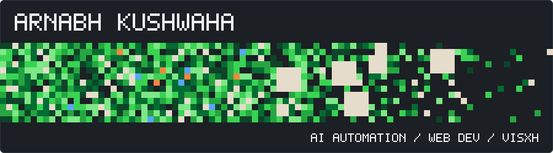
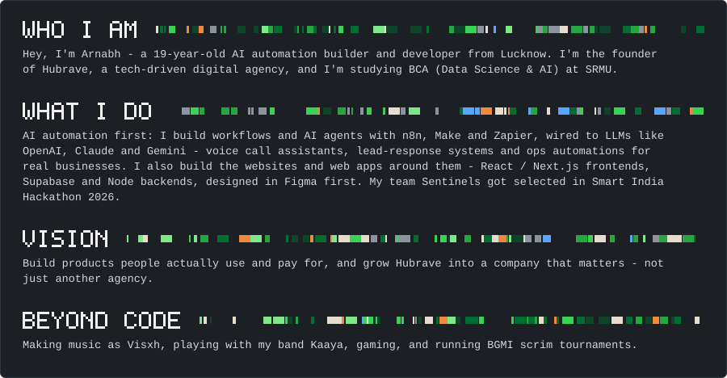
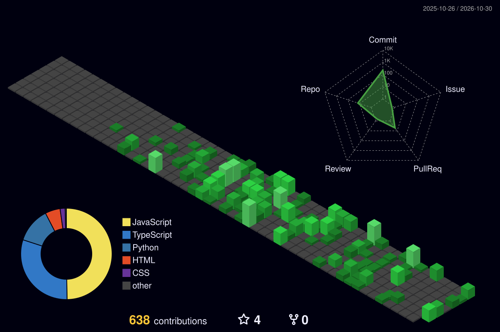
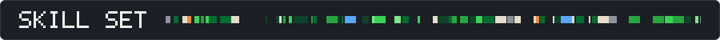

  

 

  

<table>
  <tr><th>LinkedIn</th><th>X (Twitter)</th><th>Instagram</th><th>Gmail</th></tr>
  <tr><td align="center"></td><td align="center"></td><td align="center"></td><td align="center"></td></tr>
</table>

 

  

<table>
  <tr>
    <td align="center" width="96"> HTML</td>
    <td align="center" width="96"> CSS</td>
    <td align="center" width="96"> JS</td>
    <td align="center" width="96"> React</td>
    <td align="center" width="96"> Next.js</td>
    <td align="center" width="96"> Vite</td>
    <td align="center" width="96"> Node.js</td>
    <td align="center" width="96"> Python</td>
  </tr>
  <tr>
    <td align="center" width="96"> Java</td>
    <td align="center" width="96"> C</td>
    <td align="center" width="96"> Pandas</td>
    <td align="center" width="96"> NumPy</td>
    <td align="center" width="96"> Supabase</td>
    <td align="center" width="96"> Firebase</td>
    <td align="center" width="96"> MongoDB</td>
    <td align="center" width="96"> MySQL</td>
  </tr>
  <tr>
    <td align="center" width="96"> SQLite</td>
    <td align="center" width="96"> Figma</td>
    <td align="center" width="96"> Git</td>
    <td align="center" width="96"> GitHub</td>
    <td align="center" width="96"> Vercel</td>
    <td align="center" width="96"> Cloudflare</td>
    <td align="center" width="96"> AWS</td>
    <td align="center" width="96"> GCP</td>
  </tr>
</table>

